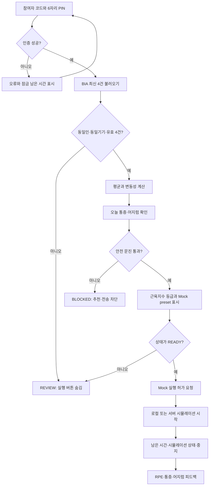
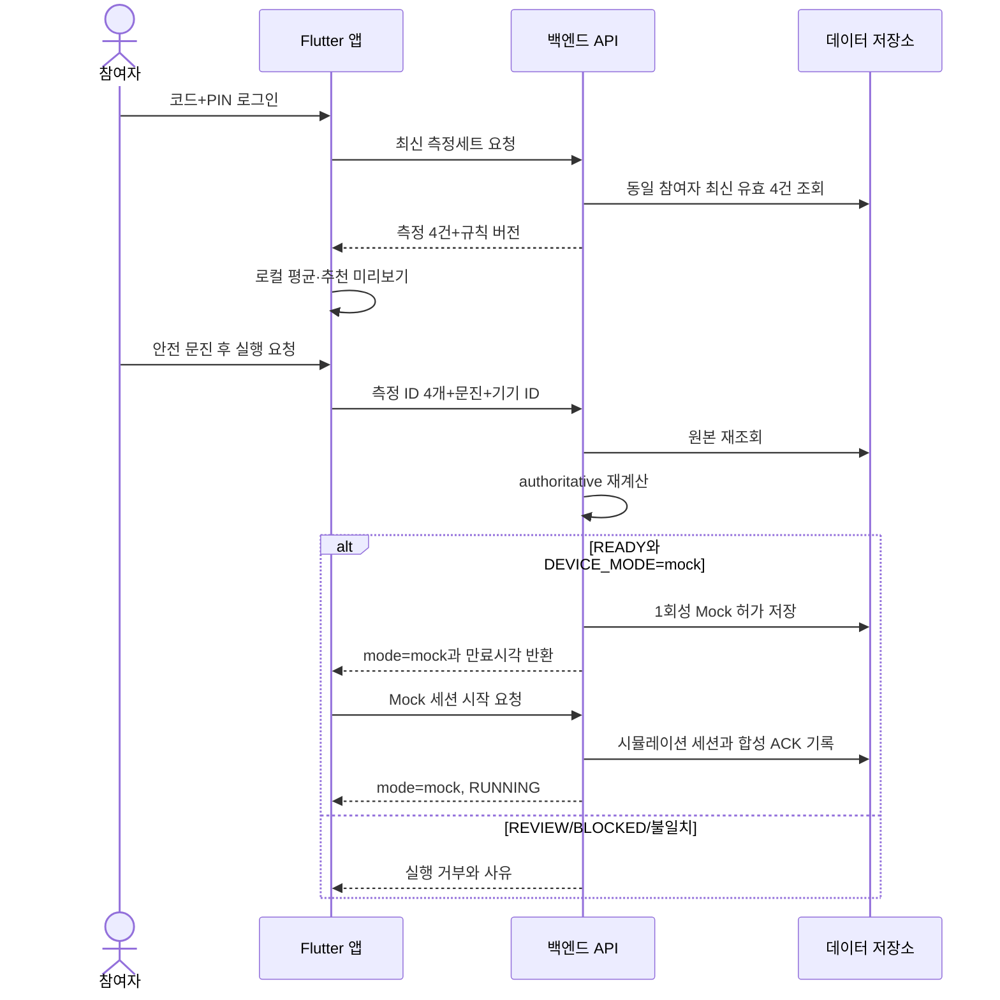
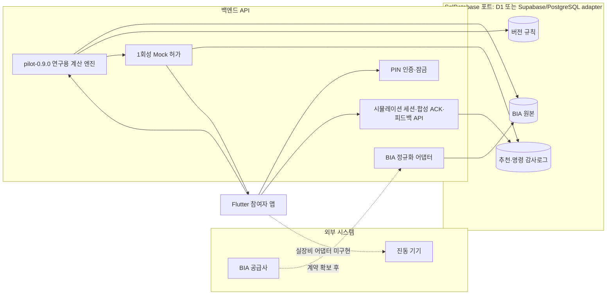
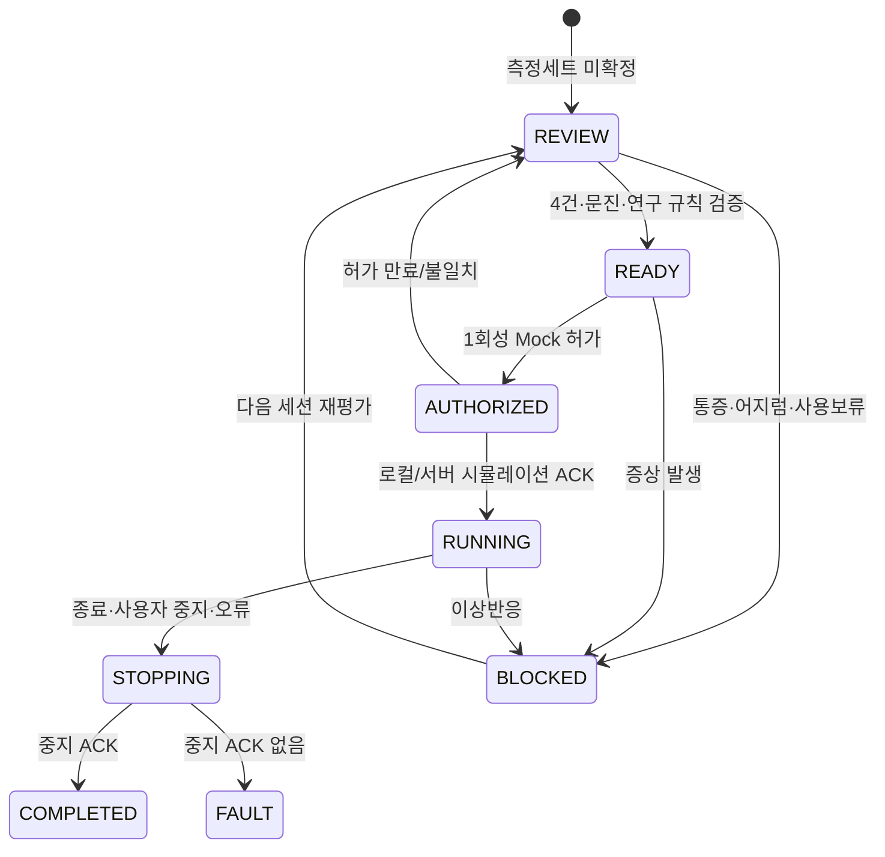

# VibeCare 유스케이스와 시스템 설계

## 운영 생활 AI 연결 경로 (2026-10-15)

`Flutter Supabase 세션 → wellness-advice Edge Function(verify_jwt=true, Auth 검증) → 사용자 RLS 측정 RPC/일별 quota RPC → OpenAI Responses`. 공개 Pages와 Android의 기존 Supabase 세션을 사용한다. PIN 토큰을 만들거나 기존 Hono 세션과 공유하지 않는다. 함수의 공급자 독립 로직은 backend-api/supabase/functions/wellness-advice/core.ts에 두고 기존 Vitest에서 검증한다. 앱의 요청/취소·오류 계약은 Wellness AI 서비스, 동의·결과 표시는 생활 탭 전용 위젯이 맡는다. 새 외부 패키지는 추가하지 않는다. 이전 후보 비교와 미연결 이력은 아래에 보존한다. 최신 승인 범위와 가동 기준은 project-overview.md의 실제 AI 계약이 우선한다.

## 실제 AI 공급자 선정 제안 — 미연결 (2026-10-07)

현재 실제 AI 연결 코드는 추가되지 않았다. 2026-10-06 자동 승인 검토가 OpenAI로 전송할 건강정보와 목적지에 대한 명시적 승인 부재로 코드 추가를 거절했다. UI 개선은 계속하며 AI 전송 승인·사용자 소유 서버 키·운영 API 주소를 기다린다. 승인이 없으면 다른 도구나 공급자로 우회하지 않는다.

| 후보 | 확인한 조건 | 이 앱에서의 판단 |
| --- | --- | --- |
| OpenAI GPT-6 Luna API | 입력100만 토큰 $0.10·출력 $0.50, 구조화 출력 지원, Free tier 미지원 | 제한된 카탈로그 ID 선택에 우선 추천. 실제 한국어 품질·계정 접근·지연은 미검증 |
| OpenAI GPT-5.4 Mini API | 입력100만 토큰 $0.75·출력 $4.50, 구조화 출력 지원 | Luna 평가가 실패하면 같은 합성 평가셋으로 비교할 대안. 무조건 자동 전환하지 않음 |
| Gemini 무료/유료 API | 무료 서비스는 입력·출력을 제품 개선에 사용하며 민감정보 제출 금지; 유료는 별도 데이터 조건 | 합성 데이터 실험 가능. 실제 건강정보에 무료 서비스를 기본 연결하지 않음. 유료는 대안이나 이번 선택의 우위 품질을 입증한 것은 아님 |

선정 이유는 반복 가능한 JSON 응답·저비용·기존 fetch/Dio와의 작은 통합 범위다. ChatGPT/Codex 플러그인 설치가 앱 자체의 AI API 인증이나 사용료를 제공하는 것은 아니다. 가정상 요청당 입력2000·출력256 토큰이면 Luna 1000회 모델 비용은 약 $0.328이며, 실제 토큰·호스팅·세금·요청 실패 비용은 다를 수 있다. 무료 월 횟수를 약속하지 않는다.

제안 경로는 Flutter PIN 세션 → 기존 Hono API → OpenAI Responses API다. 공개 Supabase 홈/샘플 컨테이너에서 PIN 세션을 임의로 생성하거나 공유하지 않는다. 샘플 화면은 로컬 안내이며 외부 요청 0회다. 추후 `/v1/wellness/advice`에서 소유자 기준 최신 측정 조회, stale/품질/출처 검사, 제한·문진·기존 피드백에 따른 후보 필터, UTC 일별 원자적 DB 요청 횟수 제한, 최대 출력·timeout·비자동 재시도·엄격한 허용 ID 검사를 먼저 구현한다. 공급자 원문/건강정보·문진·응답은 DB나 로그에 저장하지 않는다. 계정/측정/문진/선호 변경과 로그아웃 시 화면 응답을 폐기한다. 이 경로와 quota 마이그레이션은 아직 구현되거나 배포되지 않았다.

OpenAI API 데이터는 기본 학습 사용 제외지만 남용 감시 로그는 최대30일 보존될 수 있다. `store:false`가 모든 보존을 제거하지 않는다. 운영의 별도 데이터 사용 허용 설정과 매 요청 전송 동의가 필요하다.

출처(선정 확인 2026-10-06, Gemini 약관 재확인 2026-10-07): [Luna](https://developers.openai.com/api/docs/models/gpt-6-luna), [Mini](https://developers.openai.com/api/docs/models/gpt-5.4-mini), [구조화 출력](https://developers.openai.com/api/docs/guides/structured-outputs), [데이터 처리](https://developers.openai.com/api/docs/guides/your-data), [Gemini 약관](https://ai.google.dev/gemini-api/terms). 계정 요금제/크레딧과 실제 서비스 품질은 미확인이다.

## 결과 AI 안내 경계 (2026-10-06)

현재 단계는 기존 결과 카드 → WellnessResultPreview로 연결한 로컬 미리보기다. 기존 생활관리 화면 파일의 결과 전용 위젯을 재사용하며 측정 수치·비교를 받아 표시한다. 사용자 id·원본 DTO·연구 등급은 미리보기 생성 입력에 사용하지 않는다. 음식·움직임 예시는 고정된 일반 교육 문구이며 실제 AI 요청·응답이 없다. 추가 폴더·의존성·서버·API·비밀값은 생성하지 않는다. 후속 연결은 `Flutter → 인증된 기존 Backend API → 선택한 AI 공급자` 경계로 설계하며, 소유권과 전송 동의·응답 검증 계약 확정 전 운영 데이터 전송을 실행하지 않는다.

## 건강관리 1차 확장 경계 (2026-10-06)

기존 샘플/계정 홈 → 공통 생활 습관 화면 → 로컬 WellnessRepository를 사용한다. 기존 secure storage 의존성으로 계정별 local key와 sample key를 분리하며 웹의 공용 브라우저가 계정 보안 경계라는 주장을 하지 않는다. 새 서버·DB·API·의존성은 추가하지 않는다. 생활 기록의 연결 데이터는 관심 습관 enum, 사용자 선택 실천/쉬기 enum, 기기의 현지 날짜이며 신규 증상·질병·투약·식사 사진은 수집하지 않는다. 측정 결과, 안전 문진, 인가와 연결해 자동 판정하지 않는다. 연결 홈은 현재 Auth 사용자 id와 일치할 때만 표시/저장하고 Auth 이벤트로 열린 화면을 잠근다. 향후 계정 간/기기 간 서버 동기화는 보존·삭제·동의·소유권과 RLS/실계정 격리 검증 계약을 마련한 뒤 별도 확장한다.

## 현재 규칙: `pilot-0.9.1` (2026-10-04)

Flutter Mock 규칙과 Backend API의 새 활성 규칙은 [연구용 계수 설계](algorithm/pilot-0.9.1-design.md)를 따른다. 성별·70세 이상·체지방 범위 이탈 시 각각 0.95를 곱해 시뮬레이터 강도만 낮춘다. 아래 `pilot-0.9.0` 설명은 이전 규칙의 기록이다. 실제 장치 실행은 계속 금지한다.

> **Owner:** 시스템 설계 담당 · **Approver:** 앱·백엔드·장치 경계 담당
>
> **Update trigger:** 구성요소 책임, 데이터 흐름, 상태 전이 또는 외부 시스템 경계가 바뀔 때
>
> **Must not contain:** 새 제품 요구사항, 완료 선언, 확인되지 않은 외부 계약

## 참여자 유스케이스

## 현재 구현된 앱·백엔드 Mock 흐름

`VIBECARE_SUPABASE_URL`과 공개용 키가 있으면 웹 기본 화면은 Supabase Auth와 사용자별 예약·측정 보기로 열린다. 샘플 시연 화면은 앱 내부 Mock 저장소와 `MockDeviceGateway`를 사용한다. 두 Supabase 설정이 없고 `VIBECARE_API_BASE_URL`이 있으면 기존 백엔드에 저장된 표준 측정값을 읽고 `BackendDeviceGateway`가 서버 시뮬레이터를 호출한다. 모든 경로에서 실제 진동 장치에는 연결되지 않는다.

FITRUS 서버 프록시·요청/응답 fixture·체성분/활력 정규화와 저장 경로는 구현돼 있다. 실장치 응답, 근육 정의·방법·단위의 공급사 근거, 호출 제한과 실제 endpoint 검증은 후속 작업이다. REST/BLE 물리 장치 어댑터는 없다.

`pilot-0.9.0`은 검증된 BIA 이력 중 최신 API 골격근량을 키²로 정규화해 등급화하고, 선택한 6개 부위에 확정 시간·Hz·강도를 추가 보정 없이 적용한다. 실제 장치 실행은 금지한다.

## 백엔드 경계

## 안전 상태 머신

현재 `DeviceGateway` 구현은 앱 내부 `MockDeviceGateway`와 서버 시뮬레이터를 호출하는 `BackendDeviceGateway`다. 어느 쪽도 물리 장치와 통신하지 않는다. REST/BLE 실장비 구현은 장치 명세·교정표·안전 승인을 확보한 뒤 같은 인터페이스 뒤에 별도 어댑터로 추가한다.

Flutter 화면은 로그인 후 `프로필·주의사항 → 골격근량 결과·직전 기록 비교 → 인체 부위·고정 설정 확인`의 로컬 표시 단계로 이동한다. 표시 단계는 서버 상태를 변경하지 않는다. 마지막 단계에서만 기존 `DeviceGateway.authorize`를 호출한다. 근육지수 등급과 부위별 고정값은 `pilot-0.9.0` 공통 알고리즘 결과를 정본으로 사용한다.

위 고정값 설명은 `pilot-0.9.0`의 기준값 기록이다. 현재 `pilot-0.9.1`은 같은 부위별 기본값에 문서 상단의 연구용 계수를 적용하며 Mock 강도만 변경한다.

## 검증과 배포 경계

`quality-gates` 하나에서 백엔드 단위/SQLite 시험, 별도 PostgreSQL HTTP 시험, Flutter 검사와 debug APK, 웹 빌드를 같은 커밋으로 실행한다. PostgreSQL 시험은 격리된 로컬 시험 DB의 실제 migration/seed와 Node 진입점을 사용한다. main의 모든 검사와 웹 빌드가 성공한 실행만 Pages에 배포하며 PR 실행에는 배포 권한이 없다. 실제 Supabase Auth/RLS와 운영 환경 시험은 별도로 기록한다.

## 상태 어휘와 책임

| 범위 | 대표 상태 | 책임 |
|---|---|---|
| UI 추천 | `SIMULATION_READY`, `REVIEW`, `BLOCKED` | 입력과 안전 문진 결과를 표시한다. 준비 상태도 Mock 시뮬레이션 자격일 뿐이다. |
| 연구 실행 검토 | `CALIBRATION_REQUIRED`, `INSUFFICIENT_DATA` | 물리 실행을 막는 근거·교정·데이터 부족을 기록한다. |
| 장치 세션 | 연결, 허가, 전송, ACK 대기, 실행, 중지, 완료, 오류 | 현재는 Mock 또는 서버 시뮬레이션 수명주기만 관리한다. |

문헌의 `HOLD` 개념은 앱 추천 상태의 `BLOCKED`에 대응하지만 공개 API 상태값으로 혼용하지 않는다.
## 예약·출석 데이터 경계 (2026-10-01)

GitHub Pages는 Supabase Auth 이메일 로그인 후 `public.visit_bookings`에 사용자별 예약·출석을 저장한다. `SupabaseParticipationRepository`와 RLS 정책은 `auth.uid()`로 소유권을 확인한다. 연결된 측정 기록은 `public.account_participants`의 관리자 연결과 RLS가 적용된 `public.vibecare_measurements` 보기를 통해 읽는다. 샘플 시연 화면은 기존 Mock 저장소와 시뮬레이터를 사용한다. Android는 로컬 `AlarmManager` 알림을 예약하고 웹은 열려 있는 화면에서 타이머로 알린다. DB 연결 문자열과 서비스 키는 브라우저에 제공하지 않는다.
주간 예약은 기존 `visit_bookings`의 독립된 회차 행으로 저장한다. 클라이언트가 선택한 4·12·52주 범위의 날짜를 생성하고 중복 날짜·시간은 건너뛴다. 출석률과 별은 저장된 `checked_in_at` 및 지난 예약의 날짜를 매번 계산하므로 화면 재진입 후에도 동기화된다. 운영 공지는 `public.announcements`의 게시 상태와 기간을 RLS로 제한해 인증 사용자에게 읽기만 허용한다. 게시와 수정은 운영자가 Supabase 관리 경로에서 수행한다.

## 사용 후 피드백과 현재 안전 문진 구분 (2026-10-03)

사용 후 설문의 이전 통증 기록은 feedback-0.4.0 강도 상한과 다음 시연 전 확인 안내로 전달한다. 사용 전 SafetyCheck의 현재 통증·어지럼·전문가 보류는 별도 차단 조건이다. 백엔드에서는 이전 통증만으로 만든 보류 기록을 0013 마이그레이션으로 제한적으로 전환하고, 이전 어지럼이나 심한 시간·주파수 불편 기록은 유지한다. UI 확인은 서버 승인과 시뮬레이터 상태 검사를 우회하지 않는다.

### Gemini 샘플 연결 (2026-10-15)

SampleHome → 기존 WellnessAiPanel의 sample 모드 → wellness-sample Edge Function → 고정 합성 입력으로 Gemini generateContent. 샘플 클라이언트는 사용자 JWT나 측정값을 전송하지 않는다. 새 함수는 publishable apikey를 직접 검증하므로 verify_jwt=false이며 실제 측정용 wellness-advice의 verify_jwt=true는 유지한다. 공개키는 비밀 인증 수단이 아니므로 DB의 원자적 공용 3/min·20/day quota가 비용/요청 폭주를 제한한다. quota RPC는 기존 비공개 RLS usage 테이블의 정해진 샘플 카운터 두 개만 바꾸는 제한적 SECURITY DEFINER 예외이며 익명에게 측정/usage 직접 접근을 주지 않는다. 외부 요청은 동의 후 한 번, 자동 재시도/실제 데이터 fallback/사용자 입력 프롬프트는 없다. 결과는 기존 검토 카탈로그 ID만 허용하고 기기/DB에 답변을 저장하지 않는다.

웹 배포는 CI에서 main.dart.js URL에 배포 커밋 rev를 붙여 캐시 키를 변경한다. 기존 브라우저가 Pages의10분 캐시 때문에 이전 코드를 실행하던 실측 문제를 방지한다. 본문 JS 내용과 소스맵·데이터 계약은 바꾸지 않으며 이후 SHA256SUMS를 생성한다.

## 합성 시연 진입 경로 (2026-10-16)

ParticipantShell의 주 버튼은 onStart로 바로 연결한다. SamplePilotScope는 기본적으로 격리한 Mock 컨테이너에서 PilotScreen을 직접 연다. 앱의 샘플 기본 홈과 명시적 샘플 홈 메뉴만 showHome=true로 SampleHome을 연다. 계정 홈에서 시연에 들어갈 때 두 번째 ParticipantShell을 쌓지 않는다.

## 합성 시연 시작 화면 (2026-10-17)

격리된 샘플 PilotScreen의 준비 화면은 대상 선택과 시연 시작만 제공한다. 시연 시작은 고정 Mock 계정으로 기존 로컬 세션을 초기화하고 선택된 DemoPersona를 적용한다. Supabase 사용자의 자격증명이나 세션을 복사하지 않는다. Backend API 모드에서만 참여자 코드·PIN 입력과 기존 로그인 동작을 제공한다.

SampleHome은 시연을 열 때마다 별도 Mock ProviderContainer를 생성한다. 닫을 때 측정 요약만 홈으로 복사하고 route의 종료 애니메이션과 위젯 해제가 완료된 뒤 컨테이너를 폐기한다. 새로운 진입에 이전 프로필·문진·장치 상태를 공유하지 않는다.

## 시연 완료와 화면 구획 (2026-10-17)

JourneySection은 Material 3 Card 기반의 제목·아이콘·표면·테두리를 공유한다. 측정 결과, 기록 비교, 상세 지표, 추천 설정과 부위 선택은 독립 구획으로 표시한다. HumanBodyMap은 중첩 도형을 합친 실루엣에 선택 영역을 한 번만 칠하고, 어깨는 실루엣 안의 양쪽 삼각근 영역으로 제한한다.

피드백 저장 성공 시 PilotController는 feedbackSession을 비우고 completedSession에 종료된 세션을 보관한다. PilotScreen은 이를 완료 요약으로 표시하며 설정 화면으로 자동 복귀하지 않는다. 저장 실패 시 설문과 응답을 유지한다. 명시적 새 시연 준비만 완료 상태와 현재 안전 문진을 초기화한다. 완료 요약의 수치는 실제 경과 시간이 아닌 종료 세션의 설정값이다. 서버/API 계약, 추천 알고리즘과 물리 실행 경계는 변경하지 않는다.

## 식사·운동 콘텐츠 우선 생활 탭 (2026-10-17)

ParticipantShell의 생활 탭 → DailyGuideScreen은 앱에 포함한 일반 안내를 표시한다. 입력은 food/movement 카테고리뿐이며 계정·측정·체성분·기기 문진이나 API 서비스를 받지 않는다. 식사 조합 선택과 운동 전 현재 상태 응답은 라우트 안의 임시 상태이며 저장·외부 전송하지 않는다. WHO Healthy diet/NHS Sitting exercises의 출처와 확인일을 함께 제공한다.

WellnessAiPanel은 생활 탭 하단의 기본 접힘 ExpansionTile에 두어 사용자가 펼치기 전 생성/연결 요청을 시작하지 않는다. 기존 서버 인증과 동의·취소·늦은 응답 폐기를 재사용한다. WellnessScreen은 별도의 실천 기록 탐색이며 로컬 저장 계약을 유지한다. 관심 체크와 오늘 응답을 구분하고 저장 성공한 응답만 선택 색과 체크로 표시한다.

## 측정 참고 콘텐츠 탐색 (2026-10-17 후속)

앞 절의 카테고리만 받는 DailyGuideScreen 계약을 대체한다. models/daily_guide.dart는 ParticipantReading, 비교 가능성/30일 신선도 확인, 관심 주제별 후보 탐색과 8/6개 고정 카탈로그를 소유한다. ParticipantShell은 읽기 전용 측정 스냅샷·clock·sample·계정 접근 상태를 넘긴다. SampleHome은 출처/기기/정의/단위/방법/근거/프로토콜을 함께 비교 키로 만들며 UNKNOWN은 비교하지 않는다. 실계정 공개 측정 view는 품질 통과 수치만 있고 비교 프로토콜이 없으므로 임의 비교 키를 만들지 않는다. 이 경우 표시된 수치에 대해 사용자가 관심 항목을 선택한다.

확인 가능한 동일 조건의 두 최신 값이 있을 때만 상대 변화가 가장 큰 항목을 최초 관심 주제로 삼는다. 생리학적 위험도·정상 범위·개인 적합성 점수로 쓰지 않으며 증감 방향에 따른 섭취량/운동량 조절을 하지 않는다. 모델·외부 API·DB 저장 없이 같은 앱에서 카탈로그 탐색만 수행한다. 현재 운동 상태 응답과 앉는 동작 필터를 라우트 메모리에 두고, 새 입력에서는 문진을 초기화하며 계정 접근 상실 시 내용 전체를 숨긴다. 전체 목록 선택 후 해당 방법으로 스크롤한다. 음식/운동의 출처 및 탐색 규칙은 접힌 상세에서 확인한다.

## 로그인 계정 자동 추천 (2026-10-17)

SupabaseHome은 SupabaseDailyGuideRepository.load를 ParticipantShell에 넘긴다. DailyGuideScreen은 실계정 안내를 열 때 이 함수를 자동 실행하여 RPC daily_guide_context로 본인 이력을 새로 읽는다. 캐시된 숫자나 합성 데이터를 실계정 추천 입력으로 대체하지 않는다. 호출 전후 Auth 사용자 ID를 확인하고 화면의 세대 번호/계정 접근 스트림으로 늦은 응답을 폐기한다. 재시도/새 측정은 기존 선택과 운동 상태 응답을 초기화한다. 관심 항목 선택 UI는 제거한다.

새 SQL 함수는 인자를 받지 않는 security invoker/stable 함수이며 기존 account_participants와 bia_measurements의 RLS를 유지한다. 연결된 참여자가 정확히 한 명일 때만 최신 10건과 품질·의미·수치 검증 여부, 출처/기기/방법/프로토콜의 비교 해시를 반환한다. 여러 참여자 연결은 임의 선택하지 않고 빈 결과로 보류한다. 원본 JSON·연락처·기기/참여자 ID는 반환하지 않는다. 최신 부적격 행도 반환하여 과거 유효값으로 조용히 대체하지 않게 한다. SQL fixture는 두 계정 분리·익명 권한 거부·미연결/다중 연결·상한·최신 부적격 행을 검사하고 항상 롤백한다. CI의 별도 loopback-only PostgreSQL 단계에서 실행한다.

GuideContext는 품질/유효 범위와 최근 30일을 확인한다. 비교 가능한 최신 두 값에서 상대 변화가 가장 큰 항목을 후보 탐색에만 사용한다. 첫 기록·변화 없음·조건 불일치는 균형식과 앉는 기본 동작 조합을 자동 제공한다. 섭취량·운동 강도 처방, 건강 등급, 신규 외부 AI 호출은 추가하지 않는다. 운영 실제 측정 0건과 로그인 실사용 검증 미실행은 코드/합성 회귀와 구분한다.

2026-10-17 본인 측정 갱신: SupabaseHome과 DailyGuideScreen이 활성/현재 화면에서 30초 간격 및 앱 복귀 시 기존 본인 읽기 경로를 재호출한다. 새 기록/검증 상태에만 추천과 운동 확인을 초기화하고 동일 데이터는 선택 상태를 유지한다. 센서 수신/공급사 전용 앱에서 운영 저장소로의 쓰기 연결을 구현한 것으로 해석하지 않는다.

2026-10-17 외부 앱 측정 수신: 별도 BLE 앱 → 같은 프로젝트의 Supabase Auth JWT → `public.submit_external_measurement(p_payload)` → 서버 본인 연결/등록 출처/검증/중복·quota → 수신 envelope와 canonical BIA의 원자적 저장 → 기존 본인 조회 및 30초 자동 안내 갱신. 기존 Hono PIN 토큰과 혼용하지 않는다. 이 수신 RPC만 좁은 security definer로 쓰며 client에게 canonical/private table 쓰기 권한을 열지 않는다. 외부 앱 선정/정의 확인 전 등록 출처는 비활성이다. 상세 계약은 `docs/external-measurement-integration.md`와 `shared-contracts/external-measurement.openapi.yaml`을 따른다.

## 작업 중심 탐색과 점진적 공개 (2026-10-17)

ParticipantShell은 홈·측정 기록·생활·예약·출석 목적지를 소유하고 기존 ParticipationScreen을 예약 목적지에 직접 넣는다. 알림의 일정 확인도 같은 목적지를 연다. 프로필은 상단에서 독립 route로 열며 계정 접근 상실 시 내용을 숨긴다. PilotScreen은 예약을 메뉴로 제공한다. _FirstLoginProfileCard는 불러온 요약을 즉시 표시하고 샘플 편집만 접힌 영역에서 허용한다. 실계정 등록정보의 기존 읽기 전용 계약은 유지한다. _SkeletalMuscleMeasurementCard는 핵심 측정과 다음 설정 안내를 한 면에 두고 상세 기준·전체 이력을 ExpansionTile로 공개한다. 데이터 조회·저장·추천 계산·기기 안전 경계는 변경하지 않는다.
